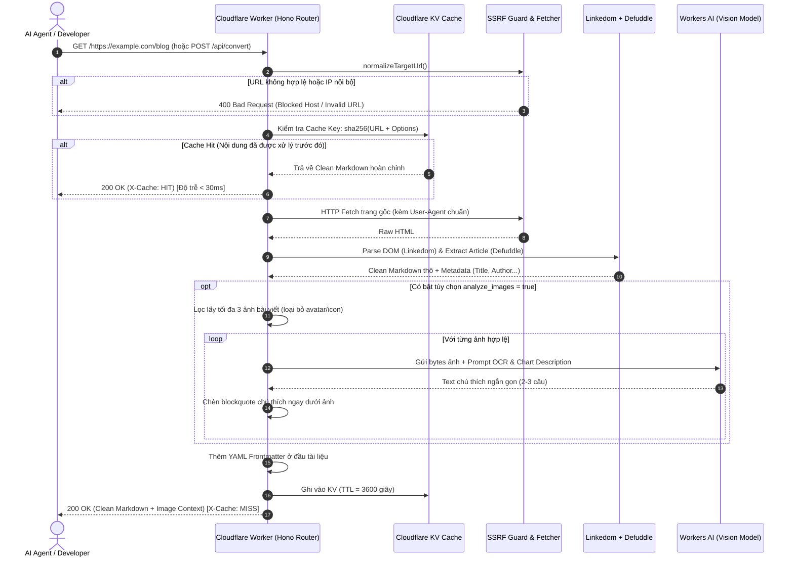

# ARCHITECTURE BLUEPRINT & SINGLE SOURCE OF TRUTH (SSOT)
# DỰ ÁN: DECRUFTMD — LEAN WEB CONTEXT LAYER FOR AI AGENTS
> **decruftmd** = *De-cruft* (gọt sạch mã rác, quảng cáo, tracking thừa thãi) + *MD* (Markdown sạch chuẩn cho AI).

> **Mục đích:** Tài liệu này là **Kim chỉ nam kỹ thuật duy nhất (Single Source of Truth - SSOT)** đúc kết từ kiến trúc production của `anymd`. Bạn có thể sao chép tệp này trực tiếp vào thư mục gốc của dự án mới để làm đặc tả kỹ thuật (Spec/Blueprint) cho AI Agent (Cursor, Claude, Copilot) hoặc đội ngũ kỹ sư triển khai từ A đến Z mà không cần tham chiếu thêm tài liệu ngoài.

---

## MỤC LỤC
1. [Tầm nhìn & Định vị sản phẩm (Product Definition & Scope)](#1-tầm-nhìn--định-vị-sản-phẩm)
2. [Thiết kế kiến trúc hệ thống (System Architecture)](#2-thiết-kế-kiến-trúc-hệ-thống)
3. [Quyết định Tech Stack & Lý do chọn lựa (Technology Choices)](#3-quyết-định-tech-stack--lý-do-chọn-lựa)
4. [5 Design Pattern cốt lõi cần tuân thủ (Core Architectural Patterns)](#4-5-design-pattern-cốt-lõi-cần-tuân-thủ)
5. [Đặc tả hợp đồng dữ liệu & API (Data Contracts & Interfaces)](#5-đặc-tả-hợp-đồng-dữ-liệu--api)
6. [Chi tiết từng module kỹ thuật (Module Specifications)](#6-chi-tiết-từng-module-kỹ-thuật)
7. [Kế hoạch triển khai từng bước (Step-by-Step Implementation Plan)](#7-kế-hoạch-triển-khai-từng-bước)
8. [Tiêu chuẩn kiểm thử & Tiêu chí nghiệm thu (Acceptance Criteria)](#8-tiêu-chuẩn-kiểm-thử--tiêu-chí-nghiệm-thu)

---

## 1. TẦM NHÌN & ĐỊNH VỊ SẢN PHẨM

### 1.1. Tuyên ngôn bài toán (Problem Statement)
Trong kỷ nguyên AI, các LLM và AI Agent (như Cursor, Claude, Devin, ChatGPT) cần ngữ cảnh web thời gian thực để lập trình, nghiên cứu và ra quyết định. Tuy nhiên:
- **HTML thô quá bẩn:** 70–85% dung lượng HTML là thẻ script, style, tracking, quảng cáo, pop-up và thẻ điều hướng navigation $\to$ Làm ô nhiễm và cạn kiệt context window của LLM.
- **Mù hình ảnh & dữ liệu trực quan:** Mọi thông tin giá trị nhất của bài viết thường nằm ở biểu đồ kiến trúc, infographic, bảng dữ liệu chụp màn hình. Khi cào web đơn thuần, ảnh chỉ còn lại `src` hoặc `alt=""` rỗng.
- **Tốc độ & Chi phí:** Nếu để LLM tự đọc trang web bằng trình duyệt headless (Puppeteer/Playwright), mỗi trang tốn 5–15 giây và tiêu tốn hàng nghìn token không cần thiết.

### 1.2. Giải pháp (The Solution)
Xây dựng một **Edge-Native Web Context Microservice** tốc độ cao (< 500ms cho text, < 2s khi có AI vision):
- **Input:** URL trang web bất kỳ.
- **Process:** Phòng vệ SSRF $\to$ Bóc tách DOM chính quy $\to$ Chuyển sang Markdown $\to$ Nhận diện ảnh quan trọng $\to$ Gọi Vision LLM sinh chú thích $\to$ Cache độc lập.
- **Output:** Markdown sạch chuẩn GFM kèm Metadata + Chú thích trực quan cho từng hình ảnh/biểu đồ.

### 1.3. Ranh giới dự án (Scope Boundaries)
- **IN-SCOPE (Phải làm cực tốt):**
  - Chặn triệt để tấn công SSRF (chống quét mạng nội bộ).
  - DOM Readability & Extraction bằng `linkedom` + `defuddle`.
  - Image Filtering & Vision Enrichment (OCR + mô tả biểu đồ).
  - Caching tại Edge (Cloudflare KV).
  - 3 giao diện: Direct URL (`/https://...`), REST API (`POST /api/convert`), và 1 MCP Tool (`read_url`).
- **OUT-OF-SCOPE (Cắt bỏ hoàn toàn để giữ hệ thống siêu nhẹ):**
  - Không xây dựng User Auth phức tạp, OAuth 2.0 (chỉ dùng API Key cố định nếu cần bảo vệ).
  - Không làm hệ thống thanh toán, tính credit, nạp tiền (Polar/Creem).
  - Không làm CMS, Page Builder hay Database quan hệ D1 phức tạp.
  - Không cài đặt trình duyệt headless (Puppeteer/Chromium) nặng nề.

---

## 2. THIẾT KẾ KIẾN TRÚC HỆ THỐNG

### 2.1. Sơ đồ luồng xử lý tổng thể (End-to-End Sequence)



### 2.2. Phân vùng trách nhiệm Module (Module Boundaries)

| Module | Tệp tin đảm nhiệm | Nhiệm vụ duy nhất (Single Responsibility) |
| :--- | :--- | :--- |
| **Gateway & Routing** | `src/index.ts` | Định tuyến Hono, đón nhận request qua REST hoặc Direct URL, điều phối pipeline. |
| **SSRF Guard** | `src/ssrf.ts` | Thẩm định protocol, phân giải hostname, chặn dải IP Private/Loopback/Cloud Metadata. |
| **DOM Engine & Polyfill** | `src/polyfill.ts` | Giả lập môi trường trình duyệt tối thiểu (`window`, `DOMParser`, `getComputedStyle`) cho V8 isolate. |
| **Extractor** | `src/extractor.ts` | Dựng DOM qua `linkedom`, chạy `defuddle` để trích xuất bài viết chính và metadata. |
| **Vision Enricher** | `src/vision.ts` | Quét thẻ ảnh qua Markdown tokens, lọc rác, tải nhị phân ảnh và gọi AI Vision. |
| **Protocol Adapter** | `src/mcp.ts` | Cung cấp giao thức Model Context Protocol chuẩn để AI Agent kết nối trực tiếp. |

---

## 3. QUYẾT ĐỊNH TECH STACK & LÝ DO CHỌN LỰA

| Thành phần | Lựa chọn kỹ thuật | Tại sao chọn? (Lý do kiến trúc & Trade-offs) |
| :--- | :--- | :--- |
| **Runtime** | **Cloudflare Workers** | 0ms cold start, chạy phân tán tại 300+ PoP toàn cầu, chi phí rẻ vượt trội so với duy trì máy chủ VPS 24/7. |
| **Ngôn ngữ** | **TypeScript** | Hệ sinh thái xử lý DOM phong phú; loại bỏ overhead của Wasm boundary so với Rust; code tinh gọn, dễ bảo trì. |
| **Web Framework** | **Hono** (`hono`) | Siêu nhẹ (< 15KB), thiết kế riêng cho Edge/Workers, hỗ trợ type-safe bindings và routing regex linh hoạt. |
| **DOM Parser** | **`linkedom`** | Nhanh gấp 8–10 lần `jsdom`, thuần JavaScript, tiêu tốn cực ít RAM, chạy hoàn hảo trong V8 isolate. |
| **Readability** | **`defuddle`** | Bộ bóc tách thế hệ mới của anymd; tự động bỏ ads/nav/footer, trích xuất metadata và render ra Markdown trong 1 bước. |
| **Token Lexer** | **`marked`** | Phân tích cú pháp Markdown siêu tốc để phát hiện thẻ ảnh `` mà không cần parse lại HTML. |
| **Vision Model** | **Workers AI** (`@cf/meta/llama-3.2-11b-vision-instruct`) | Có sẵn trên Cloudflare, không tốn thêm chi phí API bên ngoài; có thể fallback sang `Gemini 2.5 Flash Lite` qua OpenRouter. |
| **Caching Layer**| **Cloudflare KV** | Hệ thống lưu trữ Key-Value phân tán toàn cầu, độ trễ đọc cực thấp (Read-heavy, write-rare). |

---

## 4. 5 DESIGN PATTERN CỐT LÕI CẦN TUÂN THỦ

### Pattern 1: SSRF Defense-in-Depth (Phòng vệ chiều sâu)
* **Quy tắc:** Tuyệt đối không bao giờ tin tưởng URL do người dùng cung cấp. Phải chuẩn hóa và kiểm tra IP trước khi thực hiện bất kỳ lệnh `fetch()` nào.
* **Các dải mạng phải chặn triệt để:**
  - `127.0.0.0/8` (Loopback)
  - `10.0.0.0/8`, `172.16.0.0/12`, `192.168.0.0/16` (RFC 1918 Private networks)
  - `169.254.0.0/16` (Link-local / Cloud metadata endpoint)
  - `100.64.0.0/10` (Carrier-grade NAT)
  - `::1`, `fe80::/10`, `fc00::/7` (IPv6 loopback & private)
  - Hostname: `localhost`, `metadata.google.internal`.

### Pattern 2: Caller-Independent Caching (Cache độc lập danh tính)
* **Quy tắc:** Không bao giờ đưa `user_id` hay `api_key` vào khóa Cache.
* **Công thức tạo Cache Key:**
  $$\text{CacheKey} = \text{sha256} \Big( \text{normalized\_url} + \text{images\_enabled} \Big)$$
* **Ý nghĩa:** Nếu 100 Agent khác nhau cùng đọc 1 tài liệu hoặc bài báo, chỉ request đầu tiên tốn tài nguyên cào web và gọi AI Vision. 99 request sau nhận kết quả từ KV với thời gian phản hồi dưới 30ms và chi phí 0 đồng.

### Pattern 3: Graceful Degradation (Suy thoái mềm dẻo cho AI Vision)
* **Quy tắc:** Phân tích ảnh là giá trị gia tăng (*enrichment*), không phải điều kiện tiên quyết.
* **Hành vi lỗi:** Nếu model AI Vision quá tải, ảnh bị lỗi 404, hoặc hết hạn mức API: **Hệ thống vẫn phải trả về Markdown văn bản bình thường**, chỉ bỏ qua blockquote chú thích ảnh, tuyệt đối không được ném lỗi 500 làm hỏng toàn bộ request.

### Pattern 4: Smart Image Filtering (Lọc ảnh thông minh)
* **Quy tắc:** Không gọi Vision model một cách mù quáng cho mọi thẻ `` trên web.
* **Bộ lọc rác:**
  - Bỏ qua ảnh có alt-text hoặc class chứa: `avatar`, `logo`, `icon`, `thumbnail`, `badge`, `emoji`.
  - Giới hạn cứng: Chỉ lấy **tối đa 3 đến 5 ảnh lớn nhất/đầu tiên** của bài viết để tối ưu chi phí và thời gian xử lý.

### Pattern 5: Markdown Twins & Dual Interfaces
* **Quy tắc:** Cùng một logic lõi phải phục vụ được cả người dùng lẫn AI Agent qua nhiều phương thức:
  - **Direct URL:** `https://your-domain.workers.dev/https://example.com` (tiện bấm xem ngay).
  - **REST API:** `POST /api/convert` (tiện tích hợp vào ứng dụng).
  - **MCP Tool:** Phục vụ giao thức JSON-RPC để các AI coding tool (Cursor, Claude) dùng làm tool calling.

---

## 5. ĐẶC TẢ HỢP ĐỒNG DỮ LIỆU & API

### 5.1. Direct URL Interface
- **Endpoint:** `GET /:url{https?://.+}`
- **Query Params:**
  - `images` (optional, boolean): `true` để kích hoạt phân tích ảnh bằng AI Vision. Default: `false`.
- **Response Headers:**
  - `Content-Type: text/markdown; charset=utf-8`
  - `X-Cache: HIT | MISS`
- **Response Body:** Chuỗi Markdown thuần túy.

### 5.2. REST API Interface
- **Endpoint:** `POST /api/convert`
- **Request Headers:** `Content-Type: application/json`
- **Request Body JSON:**
  ```json
  {
    "url": "https://example.com/blog/system-architecture",
    "analyze_images": true,
    "max_images": 3
  }
  ```
- **Response JSON (200 OK):**
  ```json
  {
    "ok": true,
    "cached": false,
    "title": "Kiến trúc Hệ thống Phân tán",
    "domain": "example.com",
    "word_count": 1250,
    "markdown": "---\ntitle: \"...\"\n---\n\n# Nội dung...",
    "images_analyzed": 2
  }
  ```

### 5.3. Định dạng Markdown Chuẩn Output (Chuẩn cho AI Agent)
```markdown
---
title: "Tên bài viết"
source: "https://example.com/full-path"
domain: "example.com"
word_count: 850
extracted_at: "2026-10-25T08:30:00Z"
---

# Tên bài viết

Đoạn văn bản bài viết đã được làm sạch hoàn toàn rác, banner, cookie notices...


> **[AI Visual Context]**: *Sơ đồ kiến trúc microservices gồm 3 tầng: Client, API Gateway và Database D1. Các thành phần kết nối với nhau qua giao thức HTTPS.*

## Đề mục tiếp theo
Nội dung tiếp tục của bài viết...
```

---

## 6. CHI TIẾT TỪNG MODULE KỸ THUẬT

### 6.1. File `src/polyfill.ts`
Do Cloudflare Workers là môi trường V8 Isolate không có sẵn DOM của trình duyệt, module này phải được import đầu tiên:
```typescript
import { DOMParser, parseHTML } from 'linkedom';

const g = globalThis as any;
if (!g.DOMParser) g.DOMParser = DOMParser;
if (!g.window) g.window = g;
if (!g.document) {
  const { document } = parseHTML('');
  g.document = document;
}
if (!g.Node) g.Node = { ELEMENT_NODE: 1, TEXT_NODE: 3 };
if (!g.getComputedStyle) g.getComputedStyle = () => ({ display: '' });
```

### 6.2. File `src/ssrf.ts`
Chịu trách nhiệm phân tích URL và chặn IP nội bộ:
```typescript
const BLOCKED_HOSTS = new Set([
  'localhost',
  'metadata.google.internal',
  '169.254.169.254',
]);

export function isPrivateHost(host: string): boolean {
  const h = host.toLowerCase().replace(/^\[|\]$/g, '');
  if (BLOCKED_HOSTS.has(h) || h.endsWith('.localhost') || h.endsWith('.internal') || h.endsWith('.local')) return true;
  if (/^(127\.|10\.|0\.|169\.254\.|192\.168\.)/.test(h)) return true;
  if (/^172\.(1[6-9]|2\d|3[01])\./.test(h)) return true;
  if (/^100\.(6[4-9]|[7-9]\d|1[01]\d|12[0-7])\./.test(h)) return true;
  if (h === '::1' || h.startsWith('fc') || h.startsWith('fd') || h.startsWith('fe80')) return true;
  return false;
}

export function normalizeTargetUrl(raw: string): URL {
  let s = raw.trim().replace(/^\/+/, '');
  if (!/^https?:\/\//i.test(s)) s = 'https://' + s;
  
  let url: URL;
  try {
    url = new URL(s);
  } catch {
    throw new Error('Invalid URL format');
  }

  if (url.protocol !== 'http:' && url.protocol !== 'https:') {
    throw new Error('Only HTTP and HTTPS protocols are supported');
  }
  if (!url.hostname.includes('.') || isPrivateHost(url.hostname)) {
    throw new Error('Access to private/internal addresses is forbidden');
  }
  url.hash = '';
  return url;
}
```

### 6.3. File `src/extractor.ts`
Bóc tách DOM sạch bằng `linkedom` và `defuddle`:
```typescript
import './polyfill';
import { parseHTML } from 'linkedom';
import Defuddle from 'defuddle/full';

export interface ExtractedDoc {
  title: string;
  author: string;
  published: string;
  description: string;
  markdown: string;
  domain: string;
  wordCount: number;
}

export async function extractReadableContent(html: string, pageUrl: string): Promise<ExtractedDoc> {
  const { document } = parseHTML(html);
  const defuddle = new Defuddle(document as unknown as Document, {
    url: pageUrl,
    separateMarkdown: true,
  });

  const parsed = await defuddle.parseAsync();
  const markdown = (parsed.contentMarkdown || '').trim();
  const url = new URL(pageUrl);

  return {
    title: parsed.title || url.hostname,
    author: parsed.author || '',
    published: parsed.published || '',
    description: parsed.description || '',
    markdown,
    domain: url.hostname.replace(/^www\./, ''),
    wordCount: markdown.split(/\s+/).filter(Boolean).length,
  };
}
```

### 6.4. File `src/vision.ts`
Bộ lọc ảnh và gọi AI phân tích ngữ nghĩa:
```typescript
import { marked } from 'marked';

export function extractArticleImages(markdown: string, baseUrl: string): string[] {
  const list: string[] = [];
  marked.walkTokens(marked.lexer(markdown), (token) => {
    if (token.type === 'image') {
      const isJunk = /^(avatar|logo|icon|thumbnail|badge|emoji)$/i.test(token.text.trim());
      if (!isJunk) {
        try {
          const fullUrl = new URL(token.href, baseUrl).href;
          list.push(fullUrl);
        } catch {}
      }
    }
  });
  return [...new Set(list)];
}

export async function analyzeImage(ai: any, imageUrl: string): Promise<string> {
  try {
    const res = await fetch(imageUrl, { signal: AbortSignal.timeout(5000) });
    if (!res.ok) return '';
    const bytes = [...new Uint8Array(await res.arrayBuffer())];

    const out: any = await ai.run('@cf/meta/llama-3.2-11b-vision-instruct', {
      image: bytes,
      prompt: 'Briefly describe the key informative content of this chart, diagram or image in 2 concise sentences for an AI reader.',
      max_tokens: 150,
    });
    return out?.description || out?.response || '';
  } catch (e) {
    console.error('Vision analysis skipped:', e);
    return ''; // Graceful degradation
  }
}
```

### 6.5. File `src/index.ts` (API Gateway, Caching & Pipeline Orchestrator)
```typescript
import { Hono } from 'hono';
import { normalizeTargetUrl } from './ssrf';
import { extractReadableContent } from './extractor';
import { extractArticleImages, analyzeImage } from './vision';

type Bindings = {
  CACHE: KVNamespace;
  AI: any;
};

const app = new Hono<{ Bindings: Bindings }>();

async function processUrl(targetUrlStr: string, env: Bindings, analyzeImages: boolean) {
  const targetUrl = normalizeTargetUrl(targetUrlStr);
  const cacheKey = `md:${targetUrl.href}:${analyzeImages ? 1 : 0}`;

  const cached = await env.CACHE.get(cacheKey);
  if (cached) return { markdown: cached, cached: true };

  const res = await fetch(targetUrl.href, {
    headers: {
      'User-Agent': 'Mozilla/5.0 (compatible; DecruftBot/1.0; +https://github.com/your-username/decruftmd)',
      Accept: 'text/html,application/xhtml+xml',
    },
    signal: AbortSignal.timeout(10000),
  });

  if (!res.ok) throw new Error(`Target returned HTTP ${res.status}`);
  const html = await res.text();

  const extracted = await extractReadableContent(html, targetUrl.href);
  let finalMarkdown = extracted.markdown;

  let imagesAnalyzed = 0;
  if (analyzeImages && env.AI) {
    const images = extractArticleImages(finalMarkdown, targetUrl.href).slice(0, 3);
    for (const imgUrl of images) {
      const description = await analyzeImage(env.AI, imgUrl);
      if (description) {
        const pattern = new RegExp(`(!\\[.*?\\]\\(${imgUrl.replace(/[.*+?^${}()|[\]\\]/g, '\\$&')}\\))`, 'g');
        finalMarkdown = finalMarkdown.replace(pattern, `$1\n> **[AI Visual Context]**: *${description}*\n`);
        imagesAnalyzed++;
      }
    }
  }

  const output = [
    '---',
    `title: "${extracted.title.replace(/"/g, '\\"')}"`,
    `source: "${targetUrl.href}"`,
    `domain: "${extracted.domain}"`,
    `word_count: ${extracted.wordCount}`,
    `images_analyzed: ${imagesAnalyzed}`,
    '---',
    '',
    `# ${extracted.title}`,
    '',
    finalMarkdown,
  ].join('\n');

  await env.CACHE.put(cacheKey, output, { expirationTtl: 3600 });
  return { markdown: output, cached: false, title: extracted.title, domain: extracted.domain, wordCount: extracted.wordCount, imagesAnalyzed };
}

// Direct URL Endpoint
app.get('/:url{https?://.+}', async (c) => {
  const rawUrl = c.req.path.slice(1);
  const analyzeImages = c.req.query('images') === 'true';
  try {
    const result = await processUrl(rawUrl, c.env, analyzeImages);
    return c.text(result.markdown, 200, {
      'Content-Type': 'text/markdown; charset=utf-8',
      'X-Cache': result.cached ? 'HIT' : 'MISS',
    });
  } catch (err: any) {
    return c.text(`Error: ${err.message}`, 400);
  }
});

// REST API Endpoint
app.post('/api/convert', async (c) => {
  const body = await c.req.json().catch(() => ({}));
  if (!body.url) return c.json({ error: 'Missing "url" parameter' }, 400);

  try {
    const result = await processUrl(body.url, c.env, Boolean(body.analyze_images));
    return c.json({ ok: true, cached: result.cached, ...result });
  } catch (err: any) {
    return c.json({ error: err.message }, 400);
  }
});

export default app;
```

### 6.6. File `package.json`
```json
{
  "name": "decruftmd",
  "version": "1.0.0",
  "description": "Strip the HTML noise, extract clean Markdown and AI visual context for agents",
  "type": "module",
  "scripts": {
    "dev": "wrangler dev",
    "deploy": "wrangler deploy",
    "typecheck": "tsc --noEmit"
  },
  "dependencies": {
    "defuddle": "^0.19.4",
    "hono": "^4.13.9",
    "linkedom": "^0.18.13",
    "marked": "^18.0.14"
  },
  "devDependencies": {
    "@cloudflare/workers-types": "^4.20250214.0",
    "typescript": "^5.7.3",
    "wrangler": "^3.111.0"
  }
}
```

### 6.7. File `wrangler.jsonc`
```jsonc
{
  "name": "decruftmd",
  "main": "src/index.ts",
  "compatibility_date": "2026-09-20",
  "compatibility_flags": ["nodejs_compat"],
  "kv_namespaces": [
    { "binding": "CACHE", "id": "YOUR_KV_NAMESPACE_ID" }
  ],
  "ai": { "binding": "AI" }
}
```

---

## 7. KẾ HOẠCH TRIỂN KHAI TỪNG BƯỚC (STEP-BY-STEP PLAN)

### Phase 1: Bootstrap & Plumbing (1 giờ)
- [ ] Khởi tạo git repository mới.
- [ ] Cài đặt dependencies: `hono`, `linkedom`, `defuddle`, `marked`.
- [ ] Cấu hình `wrangler.jsonc` với `compatibility_flags: ["nodejs_compat"]`.
- [ ] Tạo KV Namespace cho Cache: `npx wrangler kv namespace create CACHE`.

### Phase 2: Core Conversion Engine (2 giờ)
- [ ] Triển khai `src/polyfill.ts` để giả lập DOM.
- [ ] Triển khai `src/ssrf.ts` và viết unit test chặn IP local (`127.0.0.1`, `192.168.1.1`).
- [ ] Triển khai `src/extractor.ts` với `linkedom` + `defuddle`.
- [ ] Kiểm thử chuyển đổi trang báo/blog thực tế (như TechCrunch, VnExpress, Github).

### Phase 3: AI Vision Enrichment & KV Caching (2 giờ)
- [ ] Triển khai `src/vision.ts` lọc ảnh qua `marked` tokens.
- [ ] Kết nối binding `AI` và gọi model Vision của Cloudflare.
- [ ] Gắn cache KV theo key SHA-256 với TTL 1 giờ.

### Phase 4: Giao diện kết nối & MCP (1 giờ)
- [ ] Mở endpoint Direct URL: `GET /:url{https?://.+}`.
- [ ] Mở endpoint REST API: `POST /api/convert`.
- [ ] Mở endpoint `/mcp` cung cấp tool `read_url` cho AI Agent kết nối.

---

## 8. TIÊU CHUẨN KIỂM THỬ & TIÊU CHÍ NGHIỆM THU (ACCEPTANCE CRITERIA)

Dự án được coi là **Hoàn thành (Definition of Done)** khi thỏa mãn tất cả các tiêu chí sau:

1. **Tiêu chuẩn SSRF:**
   - Request tới `http://localhost:8787/http://127.0.0.1:80` hoặc `http://169.254.169.254` **bắt buộc bị chặn với mã HTTP 400**.
2. **Tiêu chuẩn Tốc độ (Performance):**
   - Cache Miss (văn bản thuần): Phản hồi dưới **600ms**.
   - Cache Miss (có 2-3 ảnh AI Vision): Phản hồi dưới **2.5 giây**.
   - Cache Hit: Phản hồi dưới **40ms** từ mọi nơi trên thế giới.
3. **Tiêu chuẩn Dữ liệu sạch (Cleanliness):**
   - Kết quả Markdown không được chứa bất kỳ thẻ `<script>`, `<style>`, `<iframe>` quảng cáo hay thanh menu navigation.
   - Đầu tài liệu luôn có cấu trúc YAML Frontmatter hợp lệ.
4. **Tiêu chuẩn Ổn định (Resilience):**
   - Nếu đường link ảnh bị 404 hoặc model AI Vision hết hạn mức, toàn bộ request **vẫn phải trả về Markdown thành công** (không văng lỗi 500).
